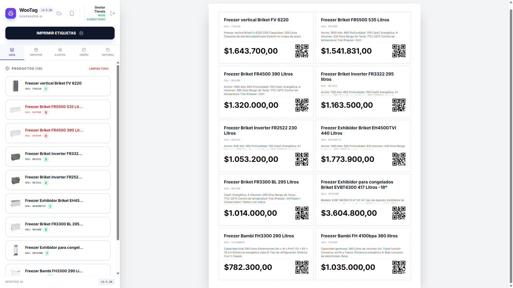
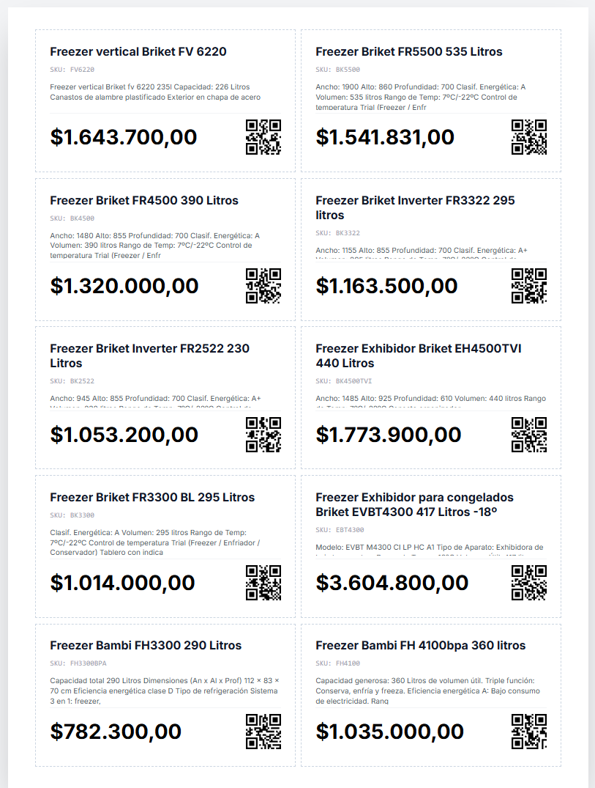
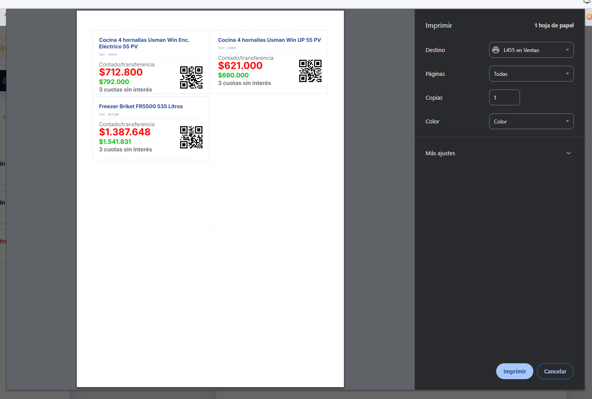
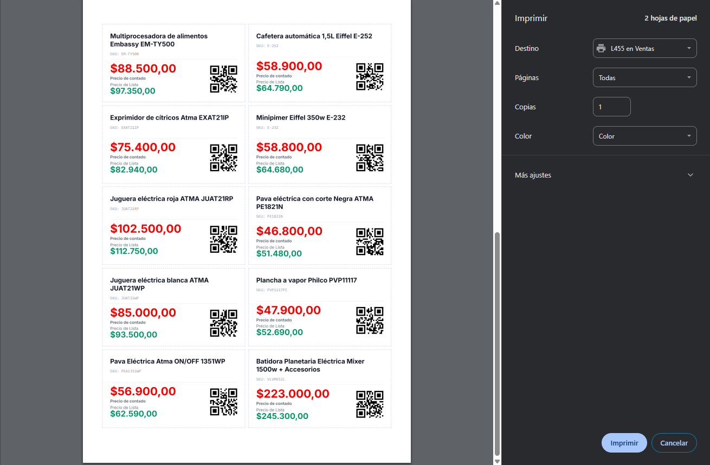
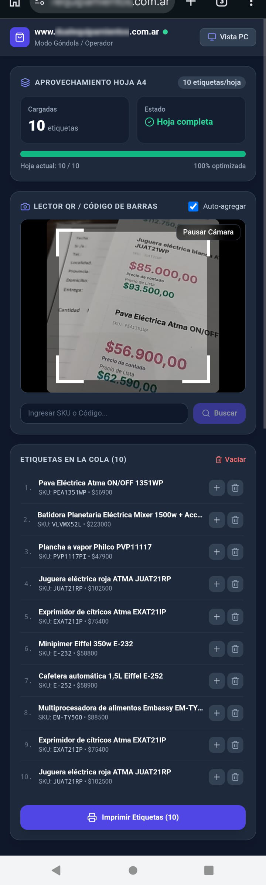
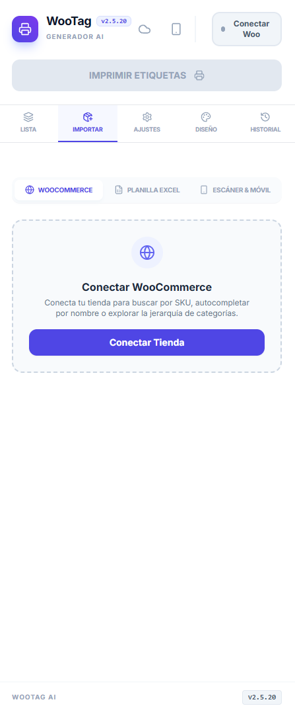
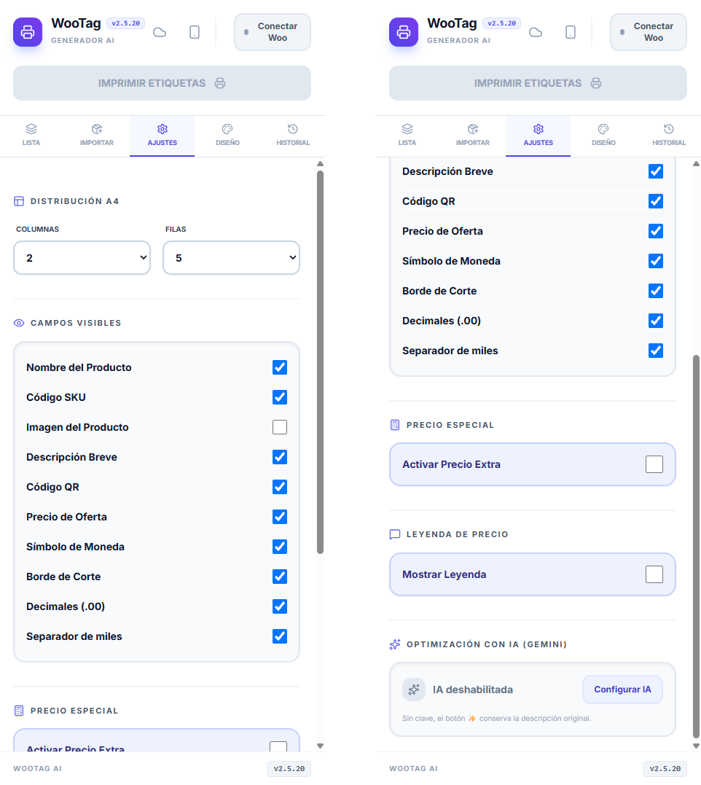
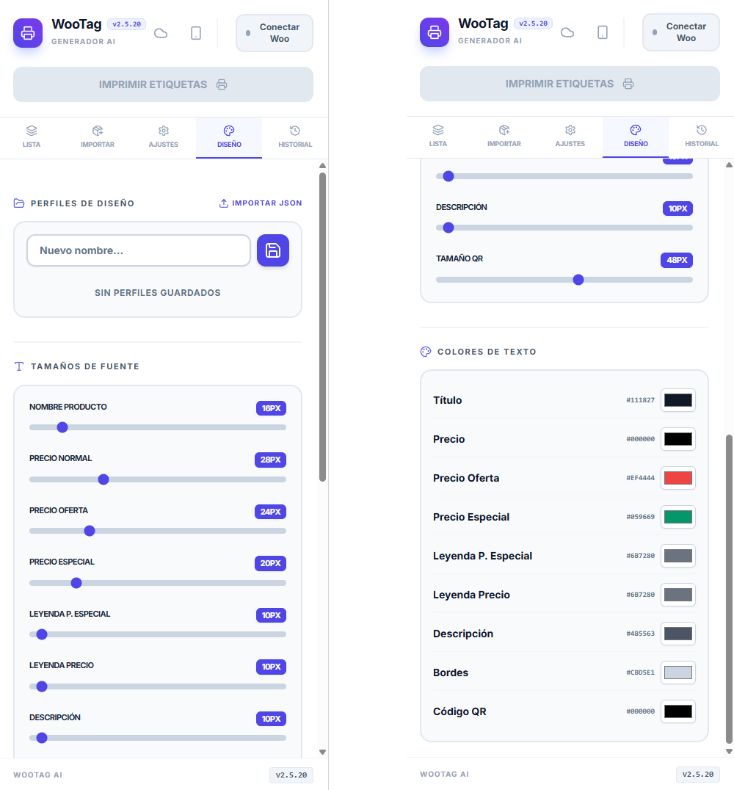
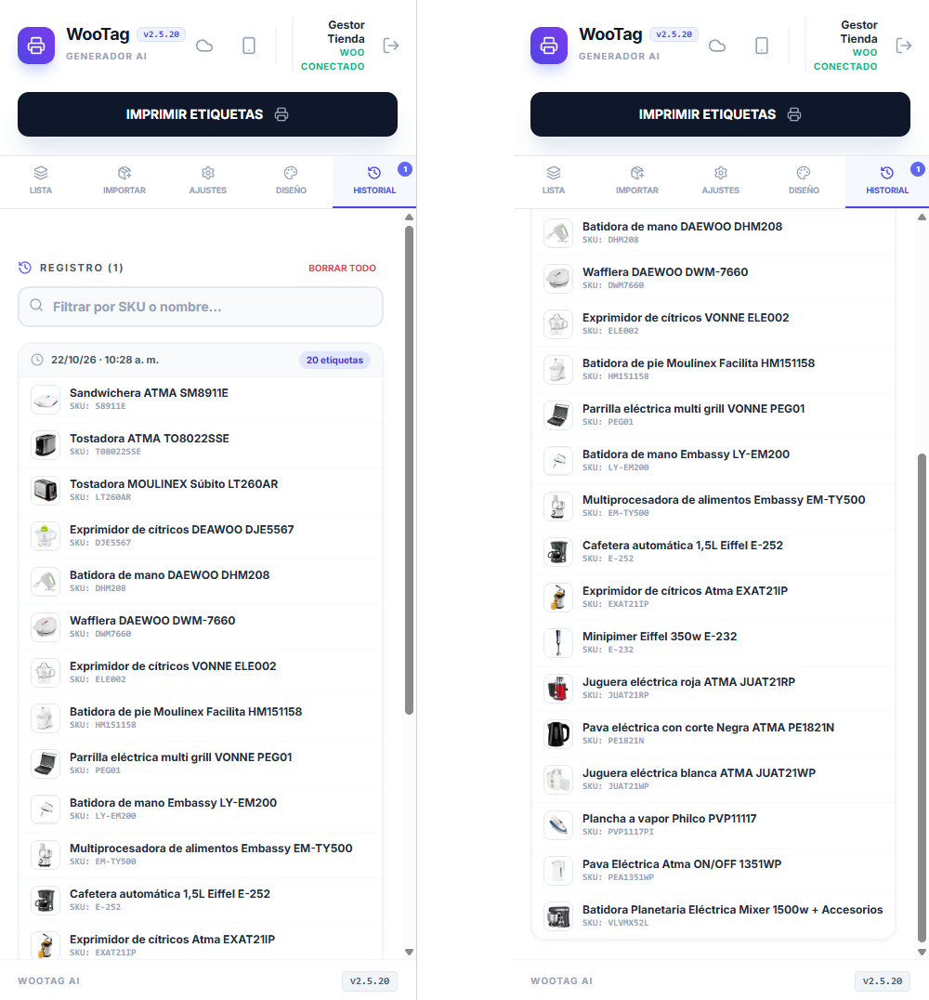
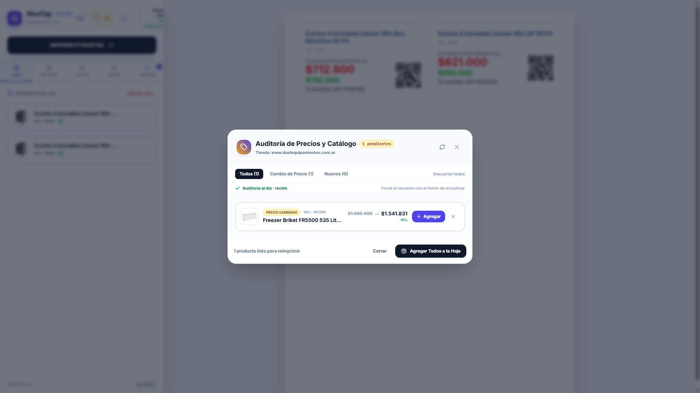

# 🏷️ WooTag AI Generator

**WooTag AI Generator** es una herramienta web para diseñar e imprimir etiquetas de precio profesionales para tiendas WooCommerce. Importa productos desde tu tienda o desde una planilla Excel, personaliza el diseño y genera hojas A4 listas para imprimir, con código QR por producto y optimización de textos vía Google Gemini AI.

Desarrollado con la asistencia de **Antigravity** (Google DeepMind).


---

## 📸 Vista Previa

> Capturas de la **v2.5.20** con 10 productos de una tienda real.

### Panel + hoja A4



> Lista de productos a la izquierda y hoja A4 a la derecha: nombre, SKU, descripción breve, precio formateado en es-AR y QR por producto. Los productos sin stock se marcan en rojo.

### Hoja A4



### Impresión (vista previa del navegador)

| 1 hoja de papel | 2 hojas de papel |
|---|---|
|  |  |

### Operador de góndola (celular)



> Escaneo continuo con cámara bajo demanda, auto-agregar, optimizador de hoja A4 y cola de etiquetas. Se entra desde `#/mobile`.

### Importar, Ajustes, Diseño, Historial y Auditoría

| Importar | Ajustes |
|---|---|
|  |  |
| WooCommerce, planilla XLS y escáner | Layout A4, campos visibles y **Optimización con IA** |

| Diseño | Historial |
|---|---|
|  |  |
| Perfiles, tamaños de fuente y colores | Impresiones registradas con sus etiquetas |

| Auditoría de precios |
|---|
|  |
| Detección de cambios de precio y SKU nuevos desde la última auditoría |

---

## 🚀 Características Principales

### ☁️ Cuenta en la Nube (Firebase)

- **Autenticación**: Login, registro y recuperación de contraseña con Firebase Authentication.
- **Sincronización Bidireccional**: Los perfiles de diseño, la configuración de etiqueta, los productos seleccionados y las credenciales de WooCommerce se sincronizan automáticamente en tiempo real (Firestore).
- **Multi-dispositivo**: Al iniciar sesión en tu teléfono, tus credenciales del PC se restauran instantáneamente, permitiendo usar el escáner móvil de inmediato sin volver a ingresar claves. Todo producto escaneado aparece mágicamente en tu computadora principal.
- Opcional — la app es completamente funcional sin cuenta.

### 📱 Modo Móvil (requiere cuenta)

- **Misma cuenta en PC y celular**: iniciá sesión con la misma cuenta cloud en el celular para heredar la configuración y las credenciales de WooCommerce.
- **Sincronización por perfil**: todo producto escaneado en el celular aparece en el PC por sincronización del perfil en Firestore (`users/{uid}`).
- **Acceso directo**: abrí `#/mobile` para entrar al modo operador móvil / góndola.

### 🔌 Integración WooCommerce

- **Modo Invitado / Offline**: La app es completamente funcional sin credenciales. Solo se requiere conexión para importar desde la API.
- **Conexión segura**: las credenciales viajan **sólo** en el header `Authorization: Basic` (nunca en la URL) y en `localStorage` se guardan ofuscadas con base64 + salt.
- **Sesión con expiración real**: la sesión de 24 h se cierra sola cuando vence (con aviso), sin necesidad de recargar.

#### Modal de Conexión

> Formulario para conectar con la API REST de WooCommerce. Acepta URL de la tienda, Consumer Key y Consumer Secret con opción de guardar localmente.

#### Importación de productos — Tab "Importar"

| Método | Descripción |
|--------|-------------|
| **Escáner QR Nativo** | Abre la cámara del dispositivo móvil para escanear el SKU de la etiqueta física y recuperar el producto desde WooCommerce automáticamente. |
| **Planilla XLS** | Descarga la plantilla oficial `.xlsx`, completá los datos y subila con drag & drop. Sin necesidad de conexión a la tienda. |
| **Por SKU** | Búsqueda exacta por código. Filtra solo productos publicados (`status=publish`). |
| **Por nombre** | Autocompletado en tiempo real (debounce 400ms) con imagen, nombre y SKU en dropdown. |
| **Por categoría** | Selector con paginación automática — obtiene **todas** las categorías, sin límite de 100. |

> Todos los métodos detectan duplicados y preguntan antes de agregar etiquetas repetidas.

---

### 📊 Importación XLS Segura

La planilla Excel oficial incluye las columnas `sku`, `name`, `price`, `sale_price`, `description`, `category`, `image_url`. El módulo aplica:

- Solo acepta `.xlsx` y `.xls`. Los archivos `.xlsm` (con macros VBA) son **rechazados**.
- Límite de **5 MB** por archivo y **500 filas** por importación.
- SheetJS con `{ cellFormula: false, cellHTML: false, bookVBA: false }` — no ejecuta fórmulas ni macros.
- Sanitización de celdas: solo `string` y `number`.
- URLs de imagen validadas: solo `http:` / `https:`. Se rechazan `javascript:`, `data:`, `file:`.

---

### 🎨 Personalización de Diseño

El panel lateral está organizado en **5 pestañas**:

| Tab | Contenido |
|-----|-----------|
| **Lista** | Lista de productos a imprimir. Botón de acceso rápido a "Importar" cuando está vacía. |
| **Importar** | Importación por XLS + API WooCommerce (SKU / Nombre / Categoría). |
| **Ajustes** | Layout A4 (filas/columnas), visibilidad de campos, Precio Especial, Leyenda de Precio. |
| **Diseño** | Perfiles de diseño guardados (guardar/cargar/eliminar/exportar/importar como JSON). |
| **Historial** | Registro de impresiones con filtro por SKU/nombre. |

#### Campos configurables por etiqueta:
- Distribución: filas × columnas en A4 (ej: 4×2, 5×3, 2×1)
- Visibilidad: nombre, SKU, imagen, descripción, QR, precio oferta, bordes, decimales, separador de miles
- **Precio Especial**: porcentaje configurable (+/-), base (regular/oferta), posición, etiqueta personalizada
- **Leyenda de Precio**: texto libre con color y tamaño independientes
- Formato: `Intl.NumberFormat('es-AR')` → `$1.234,56`

---

### 🧠 Inteligencia Artificial (Gemini AI)

- **Optimización de descripciones**: convierte textos largos en frases de venta concisas (≤ 15 palabras). Modelo `gemini-2.0-flash`.
- **Bring Your Own Key (BYOK)**: la API key se configura desde **Ajustes → Optimización con IA**, que abre un modal con el campo de la clave y el botón **"Probar API Key"** (hace una consulta genérica y exige una respuesta válida antes de dejar guardar).
- La clave se guarda **sólo en ese navegador** (`localStorage`): no se sincroniza a Firestore ni viaja en el bundle de producción.
- Sin clave (o con cuota agotada / error de red), la app **avisa** y conserva la descripción original; el botón ✨ nunca falla en silencio.

---

### 🖨️ Impresión

- Hoja A4 limpia (sin interfaz) con estilos CSS `@media print`.
- Múltiples páginas con paginación automática.
- **Indicador de páginas flotante**: badge animado actualizado en tiempo real al scrollear.
- Historial de impresiones persistido en `localStorage` con deduplicación visual por SKU (`×N`).

---

## 🛠️ Instalación y Uso

### Requisitos

- Node.js v18+
- npm
- Credenciales de la API REST de WooCommerce (Consumer Key + Consumer Secret)
- (Opcional) Proyecto Firebase para autenticación y sincronización en la nube
- (Opcional) API key de Gemini, que se configura **dentro de la app** (Ajustes → Optimización con IA), no en el build

### Pasos

```bash
# 1. Clonar el repositorio
git clone <url-del-repo>
cd WooTag

# 2. Instalar dependencias
npm install

# 3. Configurar variables de entorno
# Copiar .env.example a .env y completar los valores
cp .env.example .env

# 4. Iniciar en desarrollo
npm run dev
```

Abre `http://localhost:3000`. La app funciona en **modo diseño** sin credenciales. Para importar desde WooCommerce, hacé clic en **"Conectar"**. Para activar la nube, hacé clic en el ícono ☁️.

### Variables de Entorno

```env
# Firebase (requerido para autenticación y sincronización en la nube)
VITE_FIREBASE_API_KEY="..."
VITE_FIREBASE_AUTH_DOMAIN="proyecto.firebaseapp.com"
VITE_FIREBASE_PROJECT_ID="proyecto"
VITE_FIREBASE_STORAGE_BUCKET="proyecto.firebasestorage.app"
VITE_FIREBASE_MESSAGING_SENDER_ID="..."
VITE_FIREBASE_APP_ID="..."
VITE_FIREBASE_MEASUREMENTID="G-..."
```

> La API key de Gemini **no** va en `.env`: se carga desde la interfaz y queda sólo en el navegador.

---

## 🧪 Tests Automatizados

La aplicación cuenta con una robusta suite de pruebas unitarias y de integración que garantizan la estabilidad del sistema ante cada cambio.

```bash
npm test               # Ejecuta los 316 tests una vez
npm run test:watch     # Modo watch para desarrollo
npm run test:coverage  # Genera reporte de cobertura en /coverage
npm run typecheck      # Chequeo de tipos (tsc --noEmit, strict)
npm run lint           # ESLint (hooks + imports/vars muertos); bloquea el deploy
npm run verify:version # El deploy exige vX.Y.Z en el título y en el bundle
```

### Arquitectura de Testing
- **Motor**: [Vitest](https://vitest.dev/) (compatible con Vite, ultra rápido).
- **DOM**: [JSDOM](https://github.com/jsdom/jsdom) para simular el navegador en Node.
- **Componentes**: [React Testing Library](https://testing-library.com/docs/react-testing-library/intro/) para pruebas de comportamiento de usuario.
- **Guards de regresión**: `tests/` incluye verificaciones estáticas del propio repositorio (que no vuelvan el flujo de QR retirado, la telemetría de IP, los logs con datos de producto ni reglas de Firestore inseguras).

### Cobertura de la Suite (316 tests passing, 36 archivos)

| Grupo | Tests | Qué cubre |
|-------|-------|-----------|
| Importación y API | 83 | `xlsImport` (39): sanitización, límites, rechazo de macros. `wooService` (44): auth por header, 401/403 vs 500, paginación, normalización y `sourceId`. |
| Sincronización y nube | 54 | `cloudProfiles` (9), `priceSnapshotService` (13), auditoría con TTL (24), `AuthContext` (8): perfiles, snapshots, frescura y login. |
| IA | 31 | `geminiService` (22): resultado tipado, prueba de clave y clasificación de errores. `AiKeyModal` (5) y `LayoutTab` (4): configurar, probar, guardar y eliminar la key. |
| UI e impresión | 24 | `Tag` (8): formateo es-AR, oferta, precio especial y QR. `MobileScannerView` (5) incluye el visor de cámara siempre montado. `TagSheet` (3), `PriceAuditModal` (3), `ConnectionModal` (2) e `ImportTab` sin vinculación de dispositivos (3). |
| Guards de regresión | 63 | `firestoreRules` (17), `docsSync` (6), `noDevicePairing` (7), `noIpLogger` (5), `noDebugLogs` (4), `typesConfig` (3), `lintConfig` (4), `lazyChunks` (3), `serviceWorker` (4), `devServerConfig` (2), `mobileModeLayout` (3), `versionGate` (4). |
| Utilidades | 62 | `aiKeyStorage` (5), `security` (10), `crypto` (5), `cloudWriteBatcher` (15), `pageGeometry` (5), `productDuplicates` (5), `sessionTtl` (5), `sheetOptimizer` (6), `soundHapticService` (6). |

---

## 📦 Build para Producción

```bash
npm run build
```

Los archivos estáticos quedan en `dist/`, listos para alojar en cualquier servidor web o subcarpeta de WordPress.

La carga inicial está optimizada: `xlsx` y el escáner de cámara se descargan **bajo demanda** (al importar una planilla o abrir el escáner / `#/mobile`), no en la primera pantalla.

La app es **instalable** (PWA) pero **no funciona offline**: el service worker no cachea nada a propósito, para que cada deploy llegue en la próxima recarga.

---

## 🗂️ Estructura del Proyecto

```
App.tsx                        ← Estado global: sesión, config, perfiles, historial, auditoría, paginación
types.ts                       ← Interfaces globales + DEFAULT_CONFIG + APP_VERSION
index.tsx                      ← Bootstrap de React
vite.config.ts                 ← Build, alias, chunks y configuración de Vitest
eslint.config.js               ← Lint (ESLint 9: hooks, imports/vars muertos); bloquea el deploy
firestore.rules / firebase.json ← Reglas de seguridad de Firestore y su configuración de despliegue
├── components/
│   ├── AiKeyModal.tsx         ← Modal "Optimización con IA": pegar, probar y guardar la API key
│   ├── CloudLoginModal.tsx    ← Modal de autenticación Firebase (login/registro)
│   ├── ConnectionModal.tsx    ← Modal de conexión a WooCommerce
│   ├── Controls.tsx           ← Panel lateral con 5 tabs + punto único de alta de productos
│   ├── MobileScannerView.tsx  ← Modo operador móvil / góndola (`#/mobile`)
│   ├── PriceAuditModal.tsx    ← Auditoría de precios (pendientes, frescura, refresco)
│   ├── QrScannerModal.tsx     ← Escáner QR de productos (no vincula dispositivos)
│   ├── Tag.tsx                ← Etiqueta individual con QR y formateo de precios
│   ├── TagSheet.tsx           ← Hoja A4 paginada
│   └── controls/
│       ├── DataTab.tsx        ← Lista de productos a imprimir
│       ├── ImportTab.tsx      ← Importación (WooCommerce, XLS, escáner)
│       ├── LayoutTab.tsx      ← Ajustes de layout + configuración de IA
│       ├── DesignTab.tsx      ← Perfiles y tipografías/colores
│       └── HistoryTab.tsx     ← Historial de impresiones
├── contexts/
│   └── AuthContext.tsx        ← Contexto de autenticación Firebase
├── services/
│   ├── firebase.ts            ← Inicialización de Firebase (Auth + Firestore)
│   ├── cloudProfiles.ts       ← CRUD de perfiles en Firestore (load/update/subscribe)
│   ├── priceSnapshotService.ts ← Snapshot de precios, detección de cambios y TTL de auditoría
│   ├── geminiService.ts       ← Optimización con Gemini (BYOK) + prueba de API key
│   ├── soundHapticService.ts  ← Feedback sonoro/háptico del modo móvil
│   └── wooService.ts          ← API REST WooCommerce (auth por header, SKU, nombre, categorías)
├── utils/
│   ├── aiKeyStorage.ts        ← API key de Gemini por dispositivo (localStorage)
│   ├── cloudWriteBatcher.ts   ← Debounce de escrituras de config/perfiles + flush
│   ├── crypto.ts              ← Ofuscación en reposo de credenciales (AES-GCM, clave = uid)
│   ├── pageGeometry.ts        ← Geometría única de la hoja A4 + página por scroll
│   ├── productDuplicates.ts   ← Deduplicación por SKU compartida
│   ├── security.ts            ← Ofuscación de sesión en localStorage (base64 + salt)
│   ├── sessionTtl.ts          ← Vencimiento en vivo de la sesión de 24 h
│   ├── sheetOptimizer.ts      ← Cálculo de hojas completas / faltantes para la grilla
│   └── xlsImport.ts           ← Parseo seguro XLS (SheetJS) + plantilla
└── tests/                     ← Guards de regresión del repositorio (reglas, privacidad, logs)
```

---

## 🔐 Seguridad

| Aspecto | Implementación |
|---------|----------------|
| Credenciales WooCommerce | Cifradas con AES-GCM en Firestore usando el `uid` como clave → **ofuscación en reposo**, no confidencialidad: quien pueda leer el documento puede descifrarlas. El control real son las reglas de Firestore versionadas en `firestore.rules`. En `localStorage` se ofuscan con base64 + salt (sólo evita la inspección casual). |
| Sesión WooCommerce | Expira a las 24 h y **se cierra en vivo** (con aviso) al alcanzar el vencimiento; no hace falta recargar. |
| API Key Gemini | Se configura desde **Ajustes → Optimización con IA** y se guarda sólo en el navegador (`localStorage`). No se sincroniza a Firestore ni viaja en el bundle. |
| Privacidad / telemetría | No se registra la IP del usuario ni se contacta telemetría de terceros. La app sólo habla con tu WooCommerce, con Firebase (si usás cuenta) y con Gemini (si configurás tu API key). |
| Firebase Auth | Manejo de sesión delegado al SDK de Firebase. No se almacenan contraseñas. |
| Importación XLS | Solo `.xlsx`/`.xls`, sin macros VBA, sanitización de celdas y URLs de imagen. |

### 🔐 Reglas de Firestore

El control real de acceso a los datos son las **reglas de Firestore**, versionadas en el repositorio (`firestore.rules` + `firebase.json`). Antes vivían sólo en la consola del proyecto: no se podían auditar ni revisar en un PR.

**Qué permiten:**

- Cada usuario autenticado puede leer y escribir **únicamente** su propio documento `users/{suUid}` y sus subcolecciones (por ejemplo `users/{suUid}/snapshots/{siteId}`, los snapshots de precios).
- Todo lo demás queda **denegado por defecto**, incluida la colección `rooms` (retirada en FIX-0012). Cualquier colección nueva debe habilitarse explícitamente en las reglas.

**Despliegue (manual, desde tu máquina):**

```bash
npx firebase-tools deploy --only firestore:rules --project <TU_PROJECT_ID>
```

> No hace falta instalar nada en el proyecto: `npx` baja `firebase-tools` de forma temporal. **No** commitees el id del proyecto, credenciales ni `.env`: el project id se pasa en la línea de comandos y la autenticación la resuelve tu sesión local de Firebase.

> **Estado actual:** reglas desplegadas en el proyecto `wootag-cloud` y verificadas con el simulador de reglas (5/5 casos) y con un smoke test real de escritura en `users/{uid}/snapshots/{siteId}`.

**Checklist de verificación (con dos cuentas, A y B):**

1. Con la cuenta **A**, la app sincroniza y persiste con normalidad (perfil, sitios, productos y snapshots de precios).
2. Con la cuenta **A**, intentar leer `users/{uidDeB}` desde la consola o el SDK de Firestore es **denegado** (`permission-denied`).
3. Con la cuenta **A**, listar la colección `users` es **denegado**.
4. **Sin sesión** (deslogueado), cualquier lectura o escritura en Firestore es **denegada**.
5. `rooms/{id}` ya no se usa: cualquier lectura o escritura sobre esa ruta es **denegada**.

---

## 📌 Estado del Proyecto

En **mejora continua** — en producción (v2.5.15 · 273 tests · reglas de Firestore desplegadas y verificadas).

El estado operativo del código (mapa de módulos, invariantes y contratos abiertos) vive en `contracts/` y en el mapa del grafo (`graphify-out/PROJECT_MAP.md`).

---

## 🛣 Roadmap

- [ ] Backfill de `sourceId` para listas guardadas antes de 2.5.3 (hoy esos productos no actualizan el snapshot de precios).
- [ ] Columna `quantity` en la planilla XLS para imprimir N etiquetas del mismo producto.
- [ ] Soporte multi-hoja para importar distintos grupos de productos.
- [ ] Firebase separado de `vendor-react` para bajar el chunk de 933 KB.
- [ ] Cobertura de UI (`App`/`Controls`) y de `cloudProfiles`.
- [ ] Tailwind compilado en el build (hoy CDN) y fuentes self-hosteadas (FIX-0024).
- [ ] Accesibilidad: `aria-label` en los botones de icono de los modales.
- [ ] Modo oscuro en la interfaz de configuración.
- [ ] PWA con caché real (hoy sólo instalable, sin offline) o retiro del service worker.
- [ ] Historial de impresiones sincronizado en la nube.

---

## 👨‍💻 Autor

**Gerardo Maidana**  
Backend Developer | Java & Spring Boot  
[LinkedIn](https://linkedin.com/in/gerardomaidana) · [GitHub](https://github.com/CharlyZeta/)

---

## 🤝 Créditos

Desarrollado para potenciar la gestión de tiendas físicas WooCommerce.  